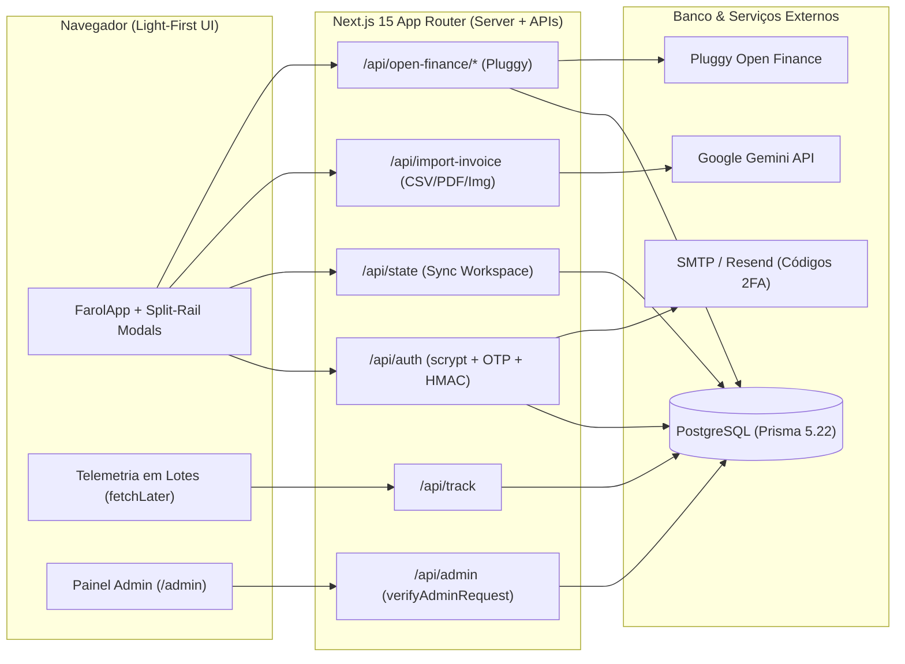

<div align="center">
  
  <h1>Farol Finanças</h1>
  <p>
    <strong>Plataforma de controle financeiro pessoal full-stack</strong> — fluxo de caixa, faturas inteligentes com IA, metas, patrimônio (% CDI/CDB), projeções, Open Finance, autenticação 2FA por e-mail e painel administrativo com telemetria em tempo real.
  </p>

  <p>
    
    
    
    
    
    
  </p>
</div>

---

## Visão Geral

O **Farol Finanças** centraliza a vida financeira pessoal em uma interface **Light-First (Sky & Porcelain)** responsiva para desktop e mobile, com persistência em nuvem via **PostgreSQL + Prisma** (Neon / Vercel Postgres) e fallback automático para `localStorage` quando executado localmente sem banco conectado.

Além da experiência do usuário final em `/`, o sistema inclui um **Painel Administrativo Privado em `/admin`**, protegido no servidor e na API para acompanhar contas cadastradas, verificações 2FA e mapa de cliques/interações em tempo real.

---

## Principais Recursos

### Gestão Financeira (10 módulos integrados)
- **Visão Geral & Lançamento Rápido**: resumo mensal, orçamento diário, alertas e criação rápida de receitas/despesas.
- **Transações, Recorrências & Fluxo de Caixa**: histórico filtrável, lançamentos recorrentes automatizados e leitura clara de entradas/saídas.
- **Faturas & Cartões**: fechamento/vencimento configurável por cartão e visão consolidada de fatura aberta vs. fechada.
- **Leitura de Faturas com IA (`/api/import-invoice`)**: extração estruturada e categorização automática de faturas (`CSV`, `.MD`, `PDF` e imagens) via Gemini Interactions API (`gemini-4-hydrogen`).
- **Categorias, Metas & Patrimônio**: regras automáticas por estabelecimento, metas com progresso visual e acompanhamento patrimonial (% CDB/CDI).
- **Projeção Estratégica & Contas**: projeções de 3M / 6M / 12M e múltiplos perfis isolados por workspace.
- **Modais Split-Rail Nativos (`<dialog>`)**: interface modal unificada, acessível por teclado e responsiva.

### Segurança, Autenticação & Isolamento de Dados
- **Senhas com `scrypt` + Salt Aleatório**: cada conta usa `randomBytes(16)` + `scryptSync(..., 64)` comparados em tempo constante com `timingSafeEqual`.
- **2FA por Código OTP (E-mail)**: códigos armazenados em hash `HMAC-SHA256`, expiração de **10 minutos**, cooldown de **55s** entre reenvios e limite de **3 tentativas** (entrega via SMTP/Nodemailer ou Resend).
- **Sessão Assinada (`farol_session`)**: cookie `HttpOnly` validado por `HMAC-SHA256` + `timingSafeEqual`, garantindo isolamento estrito entre workspaces de usuários distintos.

### Painel Admin & Telemetria (`/admin` + `/api/track`)
- **Acesso Restrito**: bloqueio SSR em `src/app/admin/page.tsx` e na API `/api/admin` exigindo cookie válido, conta verificada (`verified === true`) e presença em `PRIMARY_ADMIN_EMAIL` / `ADMIN_EMAILS`.
- **Coleta Eficiente de Cliques**: captura delegada de interações, abas, modais e fluxos de acesso enviada em lotes via `fetchLater()` com `activateAfter` (e fallback resiliente para `visibilitychange` + `sendBeacon`/`keepalive`).
- **Analytics Visual**: KPIs de contas/OTP/transações, gráfico SVG diário de 14 dias, ranking de cliques e botões, filtros por período (`24h`, `7d`, `30d`, `all`), limpeza de logs (`> 30 dias`) e tabelas responsivas com `@container`.

### Open Finance (Pluggy)
- Endpoints em `/api/open-finance/connect-token` e `/api/open-finance/webhook` com validação de assinatura (`x-pluggy-signature` / `PLUGGY_WEBHOOK_SECRET`) e upserts idempotentes via `externalId`.

---

## Arquitetura do Sistema



---

## Modelo de Dados (`prisma/schema.prisma`)

| Modelo | Finalidade |
| :--- | :--- |
| `UserAccount` | Credenciais (`email`, `passwordHash`), nome e status de verificação OTP (`verified`). |
| `OtpVerification` | Códigos 2FA temporários com `codeHash`, contador `attempts`, `used` e `expiresAt`. |
| `UserWorkspace` | Preferências do perfil (`theme`, `plan`, salários, orçamento, reserva) e snapshot completo `stateJson`. |
| `BankAccount` | Contas e cartões sincronizados com limites, dia de fechamento (`closingDay`) e vencimento (`dueDay`). |
| `Transaction` | Lançamentos estruturados por `userId`, categoria, data e `externalId` único para Open Finance. |
| `AnalyticsEvent` | Logs de telemetria (`eventType`, `target`, `label`, `tab`, `path`, `sessionId`, `userEmail`). |

---

## Variáveis de Ambiente

Configure no `.env` local e nas **Environment Variables** da Vercel:

| Variável | Obrigatória | Descrição |
| :--- | :---: | :--- |
| `DATABASE_URL` | Sim (Prod) | String de conexão PostgreSQL (Vercel Postgres / Neon). Sem ela, o app opera em modo fallback via `localStorage`. |
| `AUTH_SECRET` | Sim (Prod) | Chave secreta usada na assinatura `HMAC-SHA256` dos cookies de sessão e hashes de OTP. |
| `ADMIN_EMAILS` | Opcional | Lista extra de e-mails autorizados no `/admin` separados por vírgula (somados ao admin principal). |
| `SMTP_HOST` / `SMTP_PORT` / `SMTP_USER` / `SMTP_PASS` | Para 2FA | Credenciais SMTP (ex.: Gmail App Password) para envio dos códigos OTP pelo Nodemailer. |
| `RESEND_API_KEY` / `EMAIL_FROM` | Alternativo | Provedor HTTP alternativo (Resend) e remetente padrão dos e-mails 2FA. |
| `GEMINI_API_KEY` ou `GOOGLE_API_KEY` | Opcional | Habilita extração de faturas em PDF/Imagem e categorização por IA sem exigir chave digitada na UI. |
| `PLUGGY_CLIENT_ID` / `PLUGGY_CLIENT_SECRET` / `PLUGGY_WEBHOOK_SECRET` | Opcional | Credenciais e segredo de webhook para integração bancária Open Finance. |

---

## Rotas Principais da API

| Endpoint | Método(s) | Função |
| :--- | :--- | :--- |
| `/api/health` | `GET` | Verifica conectividade do banco (`connected` / `local-fallback`) e status do Open Finance. |
| `/api/auth` | `GET`, `POST` | Consulta sessão ativa, cadastro, login com senha, envio e validação de OTP 2FA e logout. |
| `/api/state` | `GET`, `POST` | Carrega e persiste o workspace financeiro autenticado no PostgreSQL. |
| `/api/import-invoice` | `POST` | Extrai itens de fatura (PDF/imagem) e categoriza estabelecimentos em lote via Gemini. |
| `/api/track` | `POST` | Recebe lotes de até 100 eventos de cliques/navegação e grava em `AnalyticsEvent`. |
| `/api/admin` | `GET`, `DELETE` | Entrega métricas agregadas para o `/admin` (`?range=24h\|7d\|30d\|all`) e limpa logs `> 30 dias`. |
| `/api/open-finance/connect-token` | `POST` | Gera `connectToken` do Pluggy Widget para conexão bancária. |
| `/api/open-finance/webhook` | `POST` | Recebe webhooks do Pluggy e realiza upsert seguro de transações. |

---

## Rodando Localmente

```bash
# 1. Instalar dependências
npm install

# 2. (Opcional) Configurar banco e variáveis de ambiente
cp .env.example .env

# 3. Sincronizar schema Prisma se estiver usando PostgreSQL local/remoto
npm run db:push

# 4. Iniciar servidor de desenvolvimento
npm run dev
```

Para validar o build de produção completo (`prisma generate`, `scripts/sync-db.mjs` e `next build`):

```bash
npm run build
```

---

## Deploy na Vercel

1. Conecte este repositório privado na **Vercel** e vincule um banco **PostgreSQL / Neon**.
2. Preencha `DATABASE_URL`, `AUTH_SECRET` e as credenciais de e-mail 2FA (`SMTP_*` ou `RESEND_API_KEY`) em **Settings → Environment Variables**.
3. O script de build (`npm run build`) gera o Prisma Client e executa `scripts/sync-db.mjs` automaticamente (`prisma db push`), enquanto `ensureDbSchema()` garante tabelas e índices idempotentes em runtime.

---

## Estrutura do Projeto

```text
farol-financas-next/
├── prisma/
│   └── schema.prisma              # Modelagem PostgreSQL (Auth, Workspaces, Transações, Telemetria)
├── public/
│   ├── icon.svg                   # Ícone vetorial principal do Farol
│   ├── favicon.ico                # Favicon multi-resolução (16x16 + 32x32)
│   ├── icon-192.png / icon-512.png
│   ├── apple-touch-icon.png       # Ícone iOS 180x180
│   └── manifest.json              # Manifesto PWA (tema claro)
├── scripts/
│   └── sync-db.mjs                # Sync automático do schema Prisma no build
└── src/
    ├── app/
    │   ├── admin/page.tsx         # Rota protegida do Painel Admin (SSR gate)
    │   ├── api/                   # Endpoints REST (auth, state, admin, track, invoice, open-finance, health)
    │   ├── globals.css            # Design system Light-First, modais Split-Rail & @container tables
    │   ├── layout.tsx             # RootLayout, fonte, Viewport e metadados de ícones
    │   └── page.tsx               # Entrada principal da aplicação
    ├── components/
    │   ├── AdminDashboard.tsx     # Dashboard administrativo (KPIs, gráfico 14d, rankings e logs)
    │   └── FarolApp.tsx           # Shell interativo do painel financeiro
    └── lib/
        ├── db-init.ts             # Inicialização DDL idempotente no PostgreSQL
        ├── farol-engine.js        # Motor financeiro client-side + rastreador fetchLater()
        ├── prisma.ts              # Singleton seguro do PrismaClient
        ├── session.ts             # Assinatura HMAC-SHA256 & verifyAdminRequest()
        └── shell-html.ts          # Estrutura HTML semântica do app & modais
```
